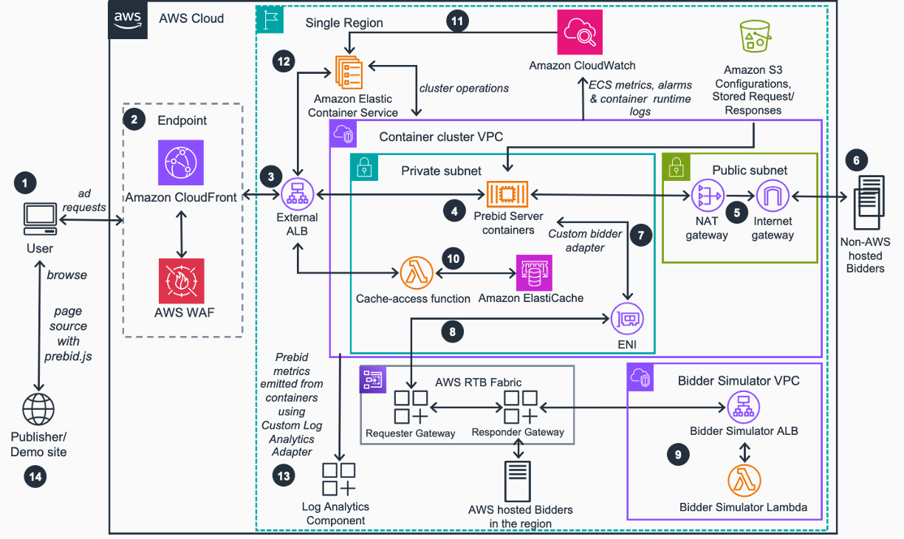
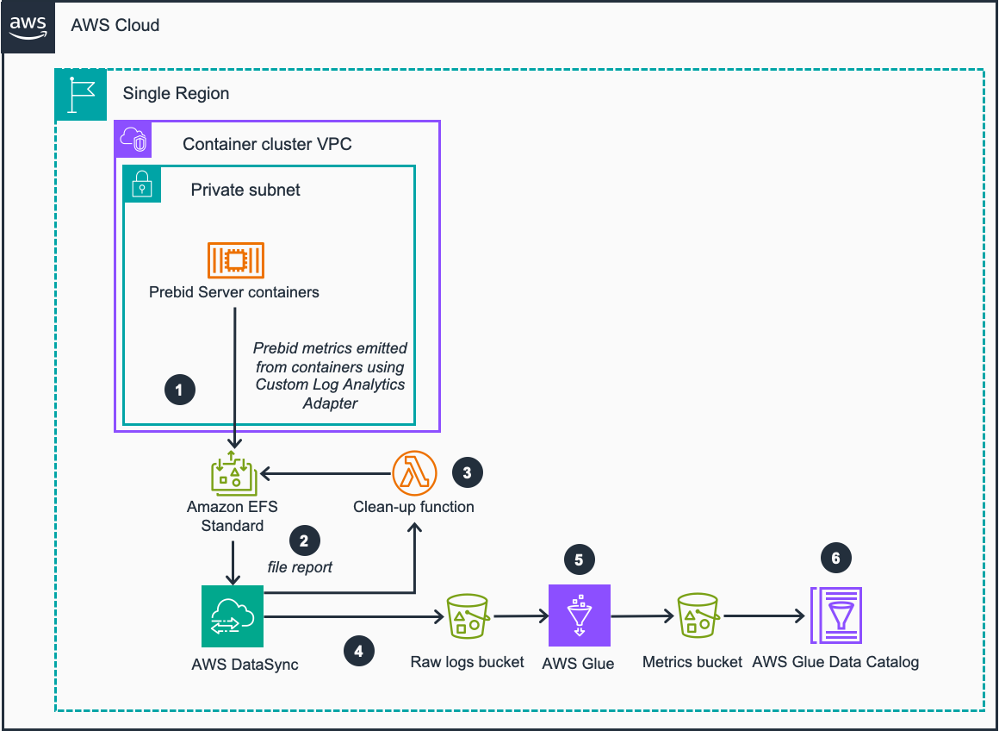

# Guidance for Deploying a Prebid Server on AWS

## Table of Contents
1. [Overview](#overview)
2. [Cost](#cost)
3. [Prerequisites](#prerequisites)
4. [Deployment Steps](#deployment-steps)
5. [Deployment Scenarios](#deployment-scenarios)
6. [CloudFormation Parameters](#cloudformation-parameters)
7. [Deployment Validation](#deployment-validation)
8. [Running the Guidance](#running-the-guidance)
9. [Next Steps](#next-steps)
10. [Cleanup](#cleanup)
11. [FAQ, Known Issues, Additional Considerations, and Limitations](#faq-known-issues-additional-considerations-and-limitations)
12. [Revisions](#revisions)
13. [Notices](#notices)
14. [Authors](#authors)

## Overview

Guidance for Deploying a Prebid Server on AWS helps customers deploy and operate Prebid Server, an open source solution for real-time ad monetization, in their own AWS environment. The solution enables customers with ad-supported websites to achieve scaled access to advertising revenue through a community of more than 180+ advertising platforms. Customers achieve full control over decision logic and access to transaction data, and realize AWS benefits like global scalability and pay-as-you-go economics.

This solution deploys v3.43.0 of [Prebid Server Java](https://github.com/prebid/prebid-server-java.git) with infrastructure in a single region of the AWS Cloud to handle a wide range of request traffic, and recording of auction and bid transaction data.

### Key Features

- **Prebid Server purpose built for AWS infrastructure**: Deploy Prebid Server in a scalable and cost-efficient manner with production-grade availability, scalability, and low-latency for a variety of request loads (documented up to 100,000 RPS).

- **Built-in observability**: Operational resource metrics, alarms, runtime logs, and business metrics, visualized with the Cost and Usage Dashboard powered by Amazon QuickSight and Service Catalog AppRegistry.

- **Decrease time to market**: Deployment template to establish the necessary infrastructure to get customers running within days instead of months or weeks.

- **Ownership of all operational and business data**: All data from Prebid Server metrics extract, transform, and load (ETL) to AWS Glue Data Catalog for seamless integration with various clients, such as Amazon Athena, Amazon Redshift, and Amazon SageMaker AI.

- **AWS RTB Fabric integration**: Optionally route bid requests through [AWS RTB Fabric](https://aws.amazon.com/rtb-fabric/), a private network purpose-built for real-time bidding. RTB Fabric provides low-latency, cost-optimized connectivity between Prebid Server and bidder endpoints without traversing the public internet. Note: RTB Fabric integration currently covers **outbound** bid requests (Prebid Server → bidders). Using RTB Fabric managed endpoints for **inbound** traffic (replacing ALB/CloudFront) is not yet supported because managed endpoints require EC2 Auto Scaling groups or EKS, and this solution runs on ECS Fargate.

- **Quick start with bidder simulator**: Deploy an optional bidder simulator stack to quickly test and validate your Prebid Server deployment without needing to configure external bidders.

- **Demo page**: Demo page can be used to validate the end-to-end flow from prebid.js through Prebid Server to the bidder simulator (see [README](source/loadtest/demo/README.md)).

**Note**: This solution consists of two CDK stacks:
1. **Main Prebid Server Stack**: The core infrastructure for running Prebid Server (always deployed)
2. **Bidder Simulator Stack**: An optional stack for quick start testing and validation that can be deployed using the `--deploy-bidding-simulator` flag

### Architecture

The solution uses AWS CDK and AWS Solutions Constructs to create well-architected applications. All AWS Solutions Constructs are reviewed by AWS and use best practices established by the AWS Well-Architected Framework. Review the [solutions guidance landing page](https://aws.amazon.com/solutions/guidance/deploying-a-prebid-server-on-aws/) for detailed architecture diagrams.

### Overall Solution Architecture


### Log Analytics Component Architecture



## Cost

You are responsible for the cost of the AWS services used while running this Guidance. As of November 2026, the cost for running this Guidance with the default settings in the US East (N. Virginia) Region is approximately $291.09 per month with no incoming bidding traffic to the solution.

We recommend creating a [Budget](https://docs.aws.amazon.com/cost-management/latest/userguide/budgets-managing-costs.html) through [AWS Cost Explorer](https://aws.amazon.com/aws-cost-management/aws-cost-explorer/) to help manage costs. Prices are subject to change. For full details, refer to the pricing webpage for each AWS service used in this Guidance.

### Sample Cost Table

The following table provides a sample cost breakdown for deploying this Guidance with the default parameters in the US East (N. Virginia) Region for one month with no incoming bidding traffic:

| AWS service  | Dimensions | Cost [USD] |
| ----------- | ------------ | ------------ |
| AWS Fargate (Amazon ECS) | 2 tasks (minimum capacity), each 2 vCPU and 4 GB memory, Linux/x86, 730 hours, 20 GB ephemeral storage (included at no charge); priced at On-Demand rates ($0.04048 per vCPU-hour, $0.004445 per GB-hour) | $144.16 |
| Elastic Load Balancing | 2 Application Load Balancers (internet-facing and internal) at $0.0225 per hour; LCU charges are negligible with no traffic | $32.85 |
| NAT gateway | 2 NAT gateways at $0.045 per hour; data processing ($0.045 per GB) is negligible with no traffic | $65.70 |
| Public IPv4 addresses | 4 in-use public IPv4 addresses (2 NAT gateway Elastic IPs, 2 for the internet-facing load balancer) at $0.005 per hour | $14.60 |
| AWS WAF | 1 web ACL ($5.00) and 7 rules (6 AWS managed rule groups and 1 custom rule) at $1.00 each; request charges ($0.60 per million) are negligible with no traffic | $12.00 |
| Amazon CloudFront | 1 distribution in front of the internet-facing Application Load Balancer. CloudFront has no fixed monthly charge; it bills per request and per GB of data transfer out, and the always-free tier covers the first 1 TB of data transfer out and 10 million HTTPS requests each month | $0.00 |
| Amazon ElastiCache Serverless (Valkey) | Minimum billed data storage of 100 MB at $0.084 per GB-hour; ECPU charges are negligible with no traffic | $6.13 |
| AWS KMS | 6 customer managed keys at $1.00 each | $6.00 |
| Amazon CloudWatch | 19 standard-resolution alarms at $0.10 each, about 5 GB of log ingestion at $0.50 per GB | $4.40 |
| Amazon EFS | About 10 GB of Standard storage at $0.30 per GB-month (files move to Infrequent Access after 7 days, which lowers this) | $3.00 |
| Amazon S3 | About 10 GB of S3 Standard storage at $0.023 per GB-month | $0.25 |
| Other services | AWS CloudTrail, AWS DataSync, AWS Lambda, Amazon VPC gateway endpoint, and IAM, which are within free tiers or negligible with no traffic | $2.00 |
| **Total** | | **$291.09** |

Prices were taken from the AWS Price List API for US East (N. Virginia) in November 2026. Amounts above are On-Demand: with the default `SpotInstanceWeight` of 1, about half of the Fargate tasks run on Fargate Spot, which lowers the Fargate line. AWS Glue (the metrics ETL job) is billed at $0.44 per DPU-hour, with a 1-minute minimum, for each run; the job runs only after a DataSync transfer delivers new log files, so its cost depends on how often Prebid Server writes metrics and analytics logs.

### AWS RTB Fabric cost comparison

AWS RTB Fabric is used when the solution is deployed with `--deploy-bidding-simulator` on the default `rtb-fabric` connectivity, or with `--enable-rtb-requester-gateway`. RTB Fabric has no hourly or gateway charge, so with no traffic it adds $0.00 to the cost above.

The tables below compare sending bid requests through the NAT gateways and through an RTB Fabric Requester Gateway, for 1 billion ad requests per month arriving through CloudFront and the Application Load Balancer. Each ad request goes to 3 bidders, so Prebid Server sends 3 billion bid requests per month. A dash (-) means the item does not apply to that option.

**Bidders on AWS in the same Region (internal RTB Fabric links)**

| Line item | Current path (NAT gateway) | AWS RTB Fabric path |
| ----------- | ------------ | ------------ |
| Amazon CloudFront requests (1 billion HTTPS at $0.0100 per 10,000) | $1,000.00 | $1,000.00 |
| Amazon CloudFront data transfer out to viewers (931 GiB at $0.085 per GB) | $79.16 | $79.16 |
| Amazon CloudFront data transfer to origin (466 GiB at $0.020 per GB) | $9.31 | $9.31 |
| AWS WAF web ACL and 7 rules | $12.00 | $12.00 |
| AWS WAF requests (1 billion at $0.60 per million) | $600.00 | $600.00 |
| Application Load Balancer hourly | $16.43 | $16.43 |
| Application Load Balancer capacity units (about 1,500 LCU-hours) | $12.00 | $12.00 |
| NAT gateway hourly (2 NAT gateways) | $65.70 | $65.70 |
| NAT gateway data processing, bid requests (27,940 GiB at $0.045 per GB) | $1,257.29 | - |
| NAT gateway data processing, bid responses (2,794 GiB at $0.045 per GB) | $125.73 | - |
| Data transfer to bidders over public IP addresses in the same Region ($0.01 per GB each direction) | $307.34 | - |
| RTB Fabric bid request transactions (3 billion at $4.50 per billion) | - | $13.50 |
| RTB Fabric payload above the 2 KiB included per transaction (22,218 GiB at $0.0015 per GiB) | - | $33.33 |
| **Total** | **$3,484.96** | **$1,841.43** |
| **Monthly difference** | | **$1,643.53 lower (47%)** |

**Bidders outside AWS (external RTB Fabric links)**

| Line item | Current path (NAT gateway) | AWS RTB Fabric path |
| ----------- | ------------ | ------------ |
| Amazon CloudFront requests | $1,000.00 | $1,000.00 |
| Amazon CloudFront data transfer out to viewers | $79.16 | $79.16 |
| Amazon CloudFront data transfer to origin | $9.31 | $9.31 |
| AWS WAF web ACL and 7 rules | $12.00 | $12.00 |
| AWS WAF requests | $600.00 | $600.00 |
| Application Load Balancer hourly | $16.43 | $16.43 |
| Application Load Balancer capacity units | $12.00 | $12.00 |
| NAT gateway hourly (2 NAT gateways) | $65.70 | $65.70 |
| NAT gateway data processing, bid requests | $1,257.29 | - |
| NAT gateway data processing, bid responses | $125.73 | - |
| Internet data transfer out to bidders (first 10 TB at $0.09 per GB, rest at $0.085) | $2,426.07 | - |
| RTB Fabric bid request transactions (3 billion at $34.00 per billion) | - | $102.00 |
| RTB Fabric payload above the 2 KiB included per transaction (22,218 GiB at $0.011 per GiB) | - | $244.39 |
| **Total** | **$5,603.69** | **$2,140.99** |
| **Monthly difference** | | **$3,462.70 lower (62%)** |

Assumptions for both tables:

* Bid requests average 10 KB uncompressed; bid responses average 1 KB (half bids of about 2 KB, half no-bids). Ad requests are 0.5 KB and browser responses 1 KB.
* Each RTB Fabric gateway is billed only for traffic it sends. The Requester Gateway pays per bid request and is not billed for responses it receives. RTB Fabric does not fan out requests, so 3 bidders means 3 transactions.
* NAT gateways process both directions, so responses add NAT processing on the current path. The RTB Fabric path does not send bid traffic through the NAT gateways.
* The NAT gateways stay in both options for other outbound traffic (image pulls, AWS API calls, bidders not on RTB Fabric), so their hourly charge is in both columns.
* Fargate, ElastiCache and the other services above are the same in both options.
* Prices are on-demand in US East (N. Virginia), without free tier or discounts; all RTB Fabric volume is in the first tier (up to 2 trillion transactions per month). See the [AWS RTB Fabric pricing page](https://aws.amazon.com/rtb-fabric/pricing/).

## Prerequisites

### Operating System

These deployment instructions are optimized to best work on **macOS, Linux, or Windows**. This solution is built with the **TypeScript AWS CDK**, so the CDK build toolchain is Node.js + npm + AWS CDK + TypeScript. The following packages and tools are required:

* [AWS Command Line Interface](https://aws.amazon.com/cli/)
* [Node.js](https://nodejs.org/en/) 20.x LTS or newer (18.x minimum) — the project targets `@types/node` 22
* [npm](https://www.npmjs.com/) (bundled with Node.js) — used to install the CDK dependencies and run the build/tests. The AWS CDK CLI (2.236.0 or newer) is installed as a project dependency by `npm ci`, and `deploy.sh` runs it with `npx`, so a global CDK install is not required.
* [Docker](https://docs.docker.com/engine/). Please ensure the Docker daemon is running before deploying. The Prebid Server container image, including its Java (Amazon Corretto 21) and Maven build, is built inside Docker, so a local JDK or Maven install is not required.
  * **Alternative**: You can use [Finch](https://github.com/runfinch/finch) as a Docker Desktop alternative. `deploy.sh` uses Finch automatically when it is installed and running, and falls back to Docker otherwise. To use Finch with CDK commands run outside `deploy.sh`, set `export CDK_DOCKER=finch`.
* [AWS access key ID and secret access key](https://docs.aws.amazon.com/IAM/latest/UserGuide/id_credentials_access-keys.html) configured in your environment with AdministratorAccess equivalent permissions

> **Python is not required for the CDK build.** Python 3 (with the `venv` module) is needed only for the non-CDK helpers: the functional/load tests (`source/loadtest/test-auction-amt.py`) and the RTB Fabric Link helper that `deploy.sh` and `destroy.sh` run on the RTB Fabric path. The helper's wrapper (`deployment/simulator-fabric-link.sh`) creates its own virtual environment and installs `deployment/requirements-fabric-link.txt` automatically. Install those requirements yourself only to run the Python load tests.

### AWS account requirements

You need an AWS account with AdministratorAccess equivalent permissions to deploy this solution.

### aws cdk bootstrap

This Guidance uses aws-cdk. If you are using aws-cdk for the first time, please perform the bootstrapping:

```bash
cdk bootstrap --cloudformation-execution-policies arn:aws:iam::aws:policy/AdministratorAccess
```

### RTB Fabric requirements

- AWS RTB Fabric must be available in your deployment region

## Deployment Steps

### 1. Quick Deploy with deploy.sh

For a streamlined deployment experience on Linux/macOS, use the provided `deploy.sh` script:

1. Clone the repo:
   ```bash
   git clone https://github.com/aws-solutions-library-samples/prebid-server-deployment-on-aws.git
   ```

2. Change to the repo folder:
   ```bash
   cd deploying-prebid-server-on-aws
   ```

3. Run the deployment script:
   ```bash
   # Deploy Prebid Server only (no simulator)
   ./deploy.sh --profile <your-aws-cli-profile> --region <your-region>

   # Deploy with analytics
   ./deploy.sh --enable-log-analytics --profile <your-aws-cli-profile> --region <your-region>

   # Deploy with bidder simulator (RTB Fabric connectivity is the default)
   ./deploy.sh --deploy-bidding-simulator --profile <your-aws-cli-profile> --region <your-region>

   # Deploy with bidder simulator using VPC peering (fallback for Regions where AWS RTB Fabric is not available)
   ./deploy.sh --deploy-bidding-simulator --simulator-connectivity vpc-peering --profile <your-aws-cli-profile> --region <your-region>

   # Deploy with all features enabled (bidder simulator over RTB Fabric + analytics)
   ./deploy.sh --deploy-bidding-simulator --enable-log-analytics --profile <your-aws-cli-profile> --region <your-region>

   # Provision an RTB Fabric Requester Gateway for partner onboarding (no simulator)
   ./deploy.sh --enable-rtb-requester-gateway --profile <your-aws-cli-profile> --region <your-region>

   # Synthesize the CloudFormation templates without deploying (runs `cdk synth --all`)
   ./deploy.sh --synth --profile <your-aws-cli-profile> --region <your-region>
   ```

   Two more flags change what the script does:
   - `--synth`: runs the same preparation steps (dependency install, TypeScript compile, config copy), then runs `cdk synth --all` instead of the two-step `cdk deploy`. Nothing gets deployed.
   - `--skip-copy`: skips copying the AMT bidder files from `source/loadtest/amt-bidder` into the Docker build context. Use it with `--deploy-bidding-simulator` when those files are already in `deployment/ecr/prebid-server/amt-bidder`. It has no effect without `--deploy-bidding-simulator`.

   The `deploy.sh` script automatically:
   - Copies AMT bidder files to the Docker build context when `--deploy-bidding-simulator` is used
   - Builds the demo website (when the simulator is deployed)
   - Installs the Node.js dependencies (`npm ci`) and compiles the TypeScript CDK (`npx tsc`)
   - Runs a two-step CDK deployment: the `BiddingServerSimulator` stack first (when requested), then the `prebid-server-deployment-on-aws` stack with CloudFormation parameters derived from the simulator stack outputs

   On the RTB Fabric path (the default when `--deploy-bidding-simulator` is used), the solution creates:
   - A **Requester Gateway** in the Prebid Server VPC (sends bid requests), provisioned by CDK when `EnableRtbRequesterGateway=true`
   - A **Responder Gateway** in the Bidder Simulator VPC (receives bid requests), provisioned by CDK
   - A **Fabric Link** connecting the two gateways through AWS RTB Fabric's private network. The Fabric Link is **not** created in CDK — after both stacks deploy, `deploy.sh` creates it by calling the external `deployment/simulator-fabric-link.sh` helper (which wraps `deployment/simulator_fabric_link.py`). This external-link model replaces the previous in-CDK Fabric Link + Accept Lambda, which could leave links stuck in `PENDING` on deletion.

   Prebid Server is then configured (via CloudFormation parameters and conditions, resolved at deploy time) to route bid requests through the RTB Fabric link URL instead of directly to the bidder simulator ALB.

   For other deployment options and usage details, run:
   ```bash
   ./deploy.sh --help
   ```
   > **Note:** The script is for quick start with minimal options. For all CDK stack options, use the manual deployment and refer to the [documentation](https://docs.aws.amazon.com/solutions/latest/prebid-server-deployment-on-aws/stack-parameters.html) for all CDK parameters.

### 2. Customization, Build and Deploy

For customization or manual deployment, follow these steps:

1. Clone the repo:
   ```bash
   git clone https://github.com/aws-solutions-library-samples/prebid-server-deployment-on-aws.git
   ```

2. Change to the repo folder:
   ```bash
   cd deploying-prebid-server-on-aws
   ```

3. Install the TypeScript CDK dependencies:
   ```bash
   cd source/infrastructure
   npm ci
   ```

4. After introducing changes, build the CDK and run the unit tests to make sure the customizations don't break existing functionality:
   ```bash
   # from source/infrastructure
   npm run build   # compiles the TypeScript CDK via tsc; fails on any compile error
   npm test        # runs the jest unit-test suite
   ```

   **Interpreting the test run:** `npm test` runs jest, which exits `0` only when every
   test passes. A green run reports zero failed and zero skipped tests. On failure, jest
   exits non-zero and prints each failing test by name (suite → test) with the assertion
   diff, so you can see exactly which construct/resource assertion broke. Fix the reported
   failures and re-run before deploying. (The `npm ci && npm run build` pair is the exact
   build command; `npm run build` is `tsc`.)

5. Build and deploy the solution:

   **Prebid Server Container Image**
   
   By default, the Prebid Server container image will be built locally using Docker ([README](deployment/ecr/README.md)). To use a pre-built or custom container image, use the `--container-image` flag with `deploy.sh` or set the `ContainerImage` CloudFormation parameter directly.

   **Manual Deployment with AWS CDK**
   
   If deploying with the bidder simulator, first copy the AMT bidder files:

   ```bash
   # Copy AMT bidder files (only needed when deploying with simulator)
   cp -r source/loadtest/amt-bidder deployment/ecr/prebid-server/
   ```

   Then deploy using CDK (two-step process):

   ```bash
   cd source/infrastructure

   # install dependencies and compile the TypeScript CDK
   npm ci && npm run build

   # bootstrap CDK (required once - deploys a CDK bootstrap CloudFormation stack for assets)  
   cdk bootstrap --cloudformation-execution-policies arn:aws:iam::aws:policy/AdministratorAccess

   # build and deploy with bidder simulator
   cdk deploy --all --context deployBiddingSimulator=true --profile <your-aws-cli-profile> --region <your-region>

   # Or deploy without bidder simulator (no file copy needed, single step)
   cdk deploy prebid-server-deployment-on-aws \
     --profile <your-aws-cli-profile> --region <your-region>
   ```

   The build-time context flag `deployBiddingSimulator` (default `false`, set in
   `cdk.json`) controls whether the `BiddingServerSimulator` stack is synthesized alongside
   the `prebid-server-deployment-on-aws` stack. All other configuration is supplied at
   **deploy time** as CloudFormation parameters, not CDK context. The key parameters on the
   `prebid-server-deployment-on-aws` stack are:

   | Parameter | Purpose |
   |---|---|
   | `EnableLogAnalytics` (`true`/`false`) | Enable the EFS → DataSync → S3 → Glue ETL analytics path |
   | `EnableRtbRequesterGateway` (`true`/`false`) | Provision the RTB Fabric Requester Gateway |
   | `ContainerImageUri` | ECR image URI; leave empty to build the image from source |
   | `SimulatorEndpoint`, `SimulatorVpcId`, `SimulatorAlbSgId`, `SimulatorRouteTableId1`, `SimulatorRouteTableId2` | VPC-peering fallback settings (used when RTB Fabric is not the connectivity model) |

   Pass parameters with `--parameters prebid-server-deployment-on-aws:<Name>=<Value>`. Because
   the simulator/Prebid parameter wiring and the RTB Fabric Link creation are multi-step, the
   `deploy.sh` script (which performs the two-step deploy and creates the Fabric Link via
   `deployment/simulator-fabric-link.sh` on the RTB path) is the recommended entry point.

   > **Note:** The RTB Fabric Link is created by the external `deployment/simulator-fabric-link.sh`
   > helper, not by CDK. RTB Fabric is driven by CloudFormation parameters (e.g.
   > `EnableRtbRequesterGateway`), not by a build-time CDK context flag, and there is no in-CDK
   > Accept Lambda.

   **Advanced Configuration**
   
   For advanced customization or troubleshooting, refer to the [loadtest component readme](./source/loadtest/README.md) which contains detailed information about bidder simulator configuration and manual CDK deployment instructions.

## Development: Project Layout, Build, Tests, and Container Bases

This solution uses the **TypeScript AWS CDK**. The infrastructure code, its unit tests, and the build/test commands are described below.

### Project layout

The CDK app and constructs live under `source/infrastructure/`:

```
source/infrastructure/
├── app.ts                       # CDK app entry point (cdk.json app = "npx ts-node app.ts")
├── cdk.json                     # CDK config + context (incl. deployBiddingSimulator)
├── package.json                 # npm scripts: build (tsc), test (jest), synth (cdk synth)
├── jest.config.js               # ts-jest test harness config
├── lib/
│   ├── prebid_server/           # PrebidServerStack constructs (*.ts)
│   ├── bidder_simulator/        # BidderSimulatorStack construct (bidder-simulator-stack.ts)
│   └── shared/                  # shared helpers (stack-constants, condition-aspect, …)
└── test/
    └── lib/                     # jest unit tests, mirroring the lib/ tree
        ├── prebid_server/
        └── bidder_simulator/
```

The two CDK stacks synthesized by this app are `prebid-server-deployment-on-aws` (the core PrebidServerStack) and `BiddingServerSimulator` (the optional bidder simulator, gated by the `deployBiddingSimulator` context flag in `cdk.json`).

### Build command

```bash
cd source/infrastructure && npm ci && npm run build
```

`npm run build` runs `tsc`, which compiles the TypeScript CDK and fails on any compile error.

### Running the unit tests

```bash
cd source/infrastructure && npm test
```

`npm test` runs the jest suite (`aws-cdk-lib/assertions` `Template` assertions over each construct). **Interpreting the result:** jest exits `0` only when every test passes — a green run reports zero failed and zero skipped tests. On failure, jest exits non-zero and names each failing test (suite → test) with the assertion diff. Fix the reported failures before declaring the change good.

### CDK synthesis (local smoke)

```bash
cd source/infrastructure && npx cdk synth --all
```

Synthesis fails non-zero on any synth error. Container-image assets are built with Docker or Finch, so set `export CDK_DOCKER=finch` if you use Finch. Synthesizing a single stack (`npx cdk synth prebid-server-deployment-on-aws`) is a faster smoke check when you don't need the simulator stack.

### Container base images

The Prebid Server container image can be built from two bases via `deployment/ecr/build-image.sh`, selected with the `--base` flag:

| Base | Flag | Notes |
|---|---|---|
| Amazon Linux 2023 | `--base al2023` (default) | Build stage `amazoncorretto:21-al2023`, deploy stage `amazonlinux:2023-minimal`. The default; larger, with glibc/dnf ecosystem alignment. |
| Alpine (jlink-tuned) | `--base alpine` | `alpine:3.23.3` with a `jlink` custom-JRE step and the `apk upgrade zlib musl musl-utils` CVE fix. The size-optimized image. |

`build-image.sh` validates `--base` against the closed set `{al2023, alpine}` (from `deployment/ecr/prebid-server/docker-build-config.json`) and defaults to `al2023` when `--base` is unset. Unsupported values fail non-zero.

> **Note:** `deploy.sh` selects the base with its own `--base-image` flag (default `alpine`) and passes it through to the CDK image asset.

**Size comparison (linux/amd64, the deploy-target platform):**

| Base | Size | Relative |
|---|---|---|
| Alpine (jlink-tuned) | ≈ 351 MiB (368,459,776 bytes) | ~36% smaller |
| AL2023 | ≈ 547 MiB (573,870,080 bytes) | ~1.56× the Alpine size |

Sizes measured with `finch image inspect --format '{{.Size}}'`. Absolute difference ≈ 196 MiB. The jlink-tuned Alpine base is the size-optimized path; AL2023 is the larger, default base.

## Deployment Validation

After deploying the solution:

1. Open the CloudFormation console and verify the status of the template with the name starting with your solution name.
2. If deployment is successful, you should see an active ECS cluster with the Prebid Server tasks running.
3. Verify that the Application Load Balancer is in service.
4. If bidder simulator is deployed, follow the instructions [here](./source/loadtest/README.md) to load test the deployment.
5. Test prebid.js integration following the instructions demo website readme [here](source/loadtest/demo/README.md).

## Running the Guidance

### Container Image Deployment

The solution supports three paths for deploying the Prebid Server container image:

#### Quick start: Pre-built container image (recommended)

A pre-built container image (`prebid-server.tar.gz`) is available as a downloadable asset on the [GitHub Release page](https://github.com/aws-solutions-library-samples/prebid-server-deployment-on-aws/releases). This is the fastest path to deployment — no local Docker build, no Maven/Java toolchain required.

**Deploy:**

1. Download `prebid-server-deployment-on-aws.zip` from the [latest release](https://github.com/aws-solutions-library-samples/prebid-server-deployment-on-aws/releases)
2. Extract and deploy:

```bash
unzip prebid-server-deployment-on-aws.zip -d prebid-server
cd prebid-server
./deploy.sh --container-image deployment/container/prebid-server.tar.gz --profile <p> --region <r>
```

The `deploy.sh` script handles everything automatically:
1. Loads the tar.gz into your local container runtime (Docker/Finch)
2. Creates an ECR repository (`prebid-server-on-aws`) if it doesn't exist
3. Tags and pushes the image to your ECR
4. Deploys the stack with `ContainerImage` pointing to the pushed URI

> **Note:** The release zip includes the pre-built container image. If you cloned the source repository directly, the tar.gz is not included — build from source instead or download the release zip.

#### Build from source

Without `--container-image`, the CDK deployment builds the container image locally from `deployment/ecr/prebid-server/` and pushes it to a CDK-managed ECR repository. The Java 21 and Maven build runs inside the container image build, so this requires only Docker or Finch, not a local JDK or Maven install:

```bash
./deploy.sh --profile <p> --region <r>
```

#### Use an existing ECR URI

If you already have a Prebid Server image in ECR:

```bash
./deploy.sh --container-image 123456789012.dkr.ecr.us-east-1.amazonaws.com/prebid-server:v1.0.0 --profile <p> --region <r>
```

### Prebid Server Java Container Customization

You may choose to customize the container configuration, or create your own container to use with this solution. The infrastructure for this solution has only been tested on Prebid Server Java.

#### Deploy with Customized Prebid Server Configurations
* After deploying the CloudFormation template stack, find the S3 bucket in the CloudFormation stack outputs named `ContainerImagePrebidSolutionConfigBucket`.
1. Review the `/prebid-server/default/README.md` and `/prebid-server/current/README.md` files in the bucket.
2. Upload your changes to the `/prebid-server/current/` prefix in that bucket.
3. To update the ECS service manually, navigate to the Amazon ECS cluster associated with the deployed CloudFormation stack using the AWS Management Console. Then, update the ECS service by selecting the 'Force New Deployment' option with the new task definition version.

### Runtime and Metric Logging for ETL

The Prebid Server container shipped with this solution is configured for two types of logging:

1. Runtime logs from the Prebid Server are sent to CloudWatch logs under the `PrebidContainerLogGroup` log group.
2. Metrics output logs are written to `/mnt/efs/metrics/CONTAINER_ID/prebid-metrics.log` with a default interval of 30 seconds.
3. Rotated logs are stored at `/mnt/efs/metrics/CONTAINER_ID/archived/prebid-metrics.TIMESTAMP.log.gz` and are migrated from EFS to S3 by AWS DataSync.

### Analytics Reporter Configuration

The solution includes a custom analytics adapter for Prebid Server. By default, the analytics integration is disabled in the [prebid-config.yaml](deployment/ecr/prebid-server/default-config/prebid-config.yaml)

```yaml
analytics:
  global:
    adapters: "psdoaAnalytics"  # Specifies the custom analytics adapter
  psdoa:
    enabled: ${LOG_ANALYTICS_ENABLED}  # Enables or Disables psdoa analytics integration
```

To enable psdoaAnalytics, deploy with `--enable-log-analytics` or set the `EnableLogAnalytics` CloudFormation parameter to `true`.

### RTB Fabric Integration

[AWS RTB Fabric](https://aws.amazon.com/rtb-fabric/) is a private network purpose-built for real-time bidding that provides low-latency, cost-optimized connectivity between ad tech participants without traversing the public internet.

#### How It Works

On the RTB Fabric connectivity path (the default when the bidder simulator is deployed, or when `--enable-rtb-requester-gateway` is used), the solution creates the following architecture:

```
Prebid Server VPC                          Bidder Simulator VPC
┌──────────────────────┐                    ┌─────────────────────┐
│  ECS Fargate Tasks   │                    │  ALB + Lambda       │
│  (Prebid Server)     │                    │  (Bidder Simulator) │
│         │            │                    │         ▲           │
│         ▼            │                    │         │           │
│  Requester Gateway ──┼── Fabric Link ─────┼── Responder Gateway │
│  (HTTPS, port 443)   │  (RTB Fabric)      │  (HTTP, port 80)    │
└──────────────────────┘                    └─────────────────────┘
```

- **Requester Gateway**: Deployed in the Prebid Server VPC via CloudFormation (enabled via `EnableRtbRequesterGateway=true`). Sends bid requests over HTTPS (port 443) through RTB Fabric.
- **Responder Gateway**: Deployed in the Bidder Simulator VPC via CloudFormation (enabled via `EnableRtbFabric=true` on BidderSimulatorStack). Receives bid requests and forwards them to the simulator ALB.
- **Fabric Link**: Connects the two gateways. Managed by the `simulator_fabric_link.py` script (not CloudFormation). The script creates the link, waits for it to become active, accepts it from the responder side (same-account simulator), and updates the ECS task definition with the link URL.
- **WaitForGateway**: A CloudFormation custom resource that polls until the Requester Gateway reaches ACTIVE state before the stack completes.

#### Fabric Link Management (`simulator_fabric_link.py`)

The Fabric Link lifecycle is managed by `deployment/simulator_fabric_link.py`, a Python script using boto3 that operates independently of CloudFormation. This approach provides faster link operations (~30 seconds vs 5-10 minutes for a stack update) and cleaner separation of concerns.

**Dependencies:** Requires `boto3 >= 1.43.0` (for RTB Fabric SDK support). Install via:
```bash
pip install -r deployment/requirements-fabric-link.txt
```
The `deploy.sh` and `destroy.sh` scripts handle this automatically.

When you deploy with `--deploy-bidding-simulator`, the `deploy.sh` script automatically invokes `simulator_fabric_link.py create` after both stacks are deployed. The script:
1. Creates the Fabric Link between the Requester and Responder Gateways
2. Polls with exponential backoff until the link becomes active
3. Accepts the link from the responder side (same-account simulator links are auto-accepted by the script)
4. Registers a new ECS task definition revision with the link URL
5. Triggers a rolling ECS deployment (~30 seconds)

The link ID is persisted in SSM Parameter Store at `/{stack-name}/fabric-link/link-id` so it can be managed across separate script invocations.

**Subcommands:**

```bash
# Create a Fabric Link
python3 deployment/simulator_fabric_link.py create \
  --stack-name prebid-server-deployment-on-aws \
  --responder-gateway-id rgw-xxx \
  --profile myprofile \
  --region us-east-1

# Check status
python3 deployment/simulator_fabric_link.py status \
  --stack-name prebid-server-deployment-on-aws \
  --profile myprofile \
  --region us-east-1

# Delete a Fabric Link
python3 deployment/simulator_fabric_link.py delete \
  --stack-name prebid-server-deployment-on-aws \
  --profile myprofile \
  --region us-east-1
```

| Subcommand | Required Options | Description |
|------------|-----------------|-------------|
| `create` | `--stack-name`, `--responder-gateway-id` | Creates a Fabric Link, waits for ACTIVE, accepts it, updates ECS task with link URL. Idempotent — if a link already exists (SSM has a link ID), prints status and exits. |
| `delete` | `--stack-name` | Deletes the Fabric Link and removes the SSM parameter. Idempotent — if no link exists, exits cleanly. |
| `status` | `--stack-name` | Prints the current link status, URL, and gateway IDs. |

All subcommands accept optional `--profile` and `--region` for AWS CLI configuration.

#### Connectivity Modes

The solution supports two connectivity modes between Prebid Server and the Bidder Simulator:

| Mode | Flag | Description |
|------|------|-------------|
| RTB Fabric | `--deploy-bidding-simulator` (default connectivity), or `--simulator-connectivity rtb-fabric` | Traffic routed through the AWS RTB Fabric private network. The Requester/Responder Gateways are CDK-managed; the Fabric Link is created after deploy by `deployment/simulator-fabric-link.sh`. |
| VPC Peering | `--simulator-connectivity vpc-peering` | Direct VPC peering connection between the two VPCs (fallback for Regions where AWS RTB Fabric is not available). Configured through the `SimulatorVpcId` / `SimulatorAlbSgId` / `SimulatorRouteTableId1` / `SimulatorRouteTableId2` / `SimulatorEndpoint` CloudFormation parameters that `deploy.sh` populates from the simulator stack outputs. |

When neither mode is applicable (no bidder simulator deployed), Prebid Server connects to external bidders over the public internet through the NAT gateways.

## Next Steps

After deploying the solution, consider the following next steps:
1. **Customize Prebid Server Configuration**: Modify the configuration files in the S3 bucket to match your specific requirements.
2. **Analyze Auction Data**: Analyze the auction data generated by psdoaAnalytics adapter using AWS analytics services like Amazon Athena or Amazon Sagemaker.
3. **Set Up Monitoring**: Configure additional CloudWatch alarms or dashboards to monitor the performance of your Prebid Server.
4. **Integrate with Your Applications**: Update your client applications to use the deployed Prebid Server.
5. **Optimize for Cost**: Review the cost tables and adjust the infrastructure based on your actual traffic patterns.

## Cleanup

To delete the deployed solution, use the provided `destroy.sh` script:

```bash
# Destroy with confirmation prompts
./destroy.sh --profile <your-aws-cli-profile> --region <your-region>

# Preview what would be destroyed (no actual deletion)
./destroy.sh --dry-run --profile <your-aws-cli-profile> --region <your-region>
```

The script automatically detects which stacks are deployed (Prebid Server, Bidder Simulator) and destroys them in the correct order. The RTB Fabric Requester/Responder Gateways are CDK-managed and are torn down with their parent stacks. On the RTB Fabric path, `destroy.sh` first deletes the externally-managed Fabric Link (via `deployment/simulator-fabric-link.sh delete`) before tearing down the stacks, since the link is not a CloudFormation resource.

For all options, run `./destroy.sh --help`.

Alternatively, you can delete stacks manually:

1. Navigate to the AWS CloudFormation console.
2. Delete the `prebid-server-deployment-on-aws` stack first.
3. Delete the `BiddingServerSimulator` stack (if deployed).
4. Note that some resources like S3 buckets with content may require manual deletion.

## FAQ, Known Issues, Additional Considerations, and Limitations

### Known Issues
 - When deploying RTB fabric components for the first time you may hit an error related to Service Linked IAM role. This could be a timing issue as the first api call is setting up IAM role in the background. Validate in IAM console that the AWS RTB Fabric Service linked role exist and Re-run the deployment again
 - The demo website uses pre-built jar files hosted on 3rd party CDN. As versions of these dependencies roll, these may need to be re-pointed

### Additional considerations

- All S3 buckets created by this solution have public access blocked and use encryption at rest.
- CloudFront deployment mode uses custom header authentication. ALB-only mode requires user-provided SSL certificates for HTTPS.
- Customers are responsible for reviewing and validating all IAM roles, policies, and security group configurations created by this solution to ensure they meet their organization's security requirements and compliance standards.
- For any feedback, questions, or suggestions, please use the issues tab under the [GitHub repository](https://github.com/aws-solutions-library-samples/prebid-server-deployment-on-aws).

## Revisions
See [CHANGELOG.md](./CHANGELOG.md) for revisions.

## Notices

Customers are responsible for making their own independent assessment of the information in this Guidance. This Guidance: (a) is for informational purposes only, (b) represents AWS current product offerings and practices, which are subject to change without notice, and (c) does not create any commitments or assurances from AWS and its affiliates, suppliers or licensors. AWS products or services are provided "as is" without warranties, representations, or conditions of any kind, whether express or implied. AWS responsibilities and liabilities to its customers are controlled by AWS agreements, and this Guidance is not part of, nor does it modify, any agreement between AWS and its customers.

## Collection of operational metrics

This solution collects anonymized operational metrics to help AWS improve the quality of features of the solution.
For more information, including how to disable this capability, please see the [implementation guide](https://docs.aws.amazon.com/solutions/latest/prebid-server-deployment-on-aws/anonymized-data-collection.html).

## Authors

For a list of contributors, please see [Contributors](https://docs.aws.amazon.com/solutions/latest/prebid-server-deployment-on-aws/contributors.html).

***

Copyright Amazon.com, Inc. or its affiliates. All Rights Reserved.

Licensed under the Apache License, Version 2.0 (the "License");
you may not use this file except in compliance with the License.
You may obtain a copy of the License at

    http://www.apache.org/licenses/LICENSE-2.0

Unless required by applicable law or agreed to in writing, software
distributed under the License is distributed on an "AS IS" BASIS,
WITHOUT WARRANTIES OR CONDITIONS OF ANY KIND, either express or implied.
See the License for the specific language governing permissions and
limitations under the License.
